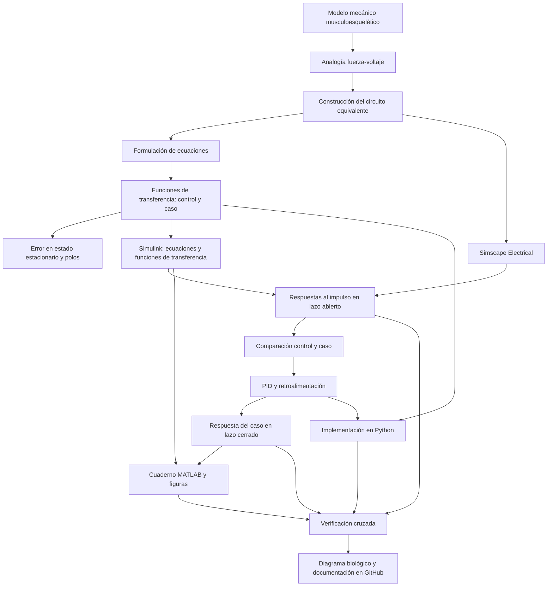

# Práctica 3 — Modelado y control del sistema musculoesquelético

Repositorio académico de la asignatura **Modelado de Sistemas Fisiológicos**, correspondiente al programa de **Ingeniería Biomédica** del Tecnológico Nacional de México / Instituto Tecnológico de Tijuana.

Durante la práctica se trabajó con una representación simplificada del sistema musculoesquelético a través de una analogía entre fuerza y voltaje. A partir del circuito equivalente se calculó la función de transferencia utilizando el principio de **superposición**. También se revisaron el error en estado estable y la estabilidad del sistema en lazo abierto. Posteriormente, se comparó el comportamiento de una condición de referencia correspondiente a un individuo sano (**control**) con una condición simulada de atrofia muscular (**caso**). Para acercar la respuesta del caso a la respuesta de referencia, se añadió un controlador **PI**.

**Estudiante:** Cid Pacheco Emmanuel 
**Número de control:** 23212187
**Correo institucional:** l23212187@tectijuana.edu.mx  
**Docente:** Dr. Paul Antonio Valle Trujillo  
**Correo del docente:** paul.valle@tectijuana.edu.mx  
**Asignatura:** Modelado de Sistemas Fisiológicos  
**Programa:** Ingeniería Biomédica  
**Departamento:** Ingeniería Eléctrica y Electrónica  
**Institución:** Tecnológico Nacional de México / Instituto Tecnológico de Tijuana

---

<a id="contenido"></a>
## Contenido

1. [Resumen](#resumen)
2. [Competencia y objetivos](#objetivos)
3. [Relación con el temario](#temario)
4. [Modelo mecánico y analogía eléctrica](#modelo-fisico)
5. [Formulación matemática](#formulacion)
6. [Análisis temporal y de estabilidad](#analisis)
7. [Condiciones de simulación](#simulacion)
8. [Implementación en MATLAB y Simulink](#matlab)
9. [Control en lazo cerrado y sintonización PID](#pid)
10. [Reproducción en Python](#python)
11. [Resultados y verificación cruzada](#resultados)
12. [Diagrama biológico](#diagrama)
13. [Flujo de trabajo](#flujo)
14. [Actividades del estudiante](#actividades)
15. [Estructura del repositorio](#estructura)
16. [Requisitos](#requisitos)
17. [Reproducibilidad y entregables](#reproducibilidad)
18. [Referencias](#referencias)

---

<a id="resumen"></a>
## 1. Resumen

El propósito de esta práctica es reproducir y verificar el modelado, análisis, simulación y control de un sistema fisiológico. El sistema musculoesquelético se representa mediante un modelo mecánico simplificado que incorpora un elemento contráctil activo, elementos elásticos y un amortiguador viscoso. A partir de la analogía fuerza–voltaje se construye un circuito eléctrico equivalente y se obtienen las ecuaciones dinámicas y las funciones de transferencia.

Se comparan dos condiciones del modelo: un individuo sano, denominado **control**, y un caso simulado de **atrofia muscular**, denominado **caso**. La diferencia entre ambas condiciones se representa mediante el cambio del parámetro resistivo equivalente \(R\). Se analiza la respuesta al impulso en lazo abierto y se incorpora un controlador PID para reducir la diferencia entre el desplazamiento del caso y el desplazamiento de referencia del control.

Las implementaciones se realizan mediante ecuaciones y funciones de transferencia en MATLAB/Simulink, circuito equivalente en Simscape Electrical y una implementación complementaria en Python. Los resultados se comparan para verificar que las distintas representaciones describan consistentemente la dinámica del modelo.

**Alcance:** la práctica se desarrolla exclusivamente mediante experimentación *in silico*. El controlador es de propósito académico y de simulación; no constituye una estrategia terapéutica para tratar la atrofia muscular.

**Palabras clave:** sistema musculoesquelético; analogía fuerza–voltaje; modelo mecánico; atrofia muscular; función de transferencia; PID; MATLAB; Simulink; Simscape Electrical; Python.

[Volver al contenido](#contenido)

---

<a id="objetivos"></a>
## 2. Competencia y objetivos

### Competencia a desarrollar

Modelizar sistemas fisiológicos mediante analogías entre sistemas físicos, ecuaciones diferenciales y funciones de transferencia, para analizar su comportamiento dinámico y diseñar estrategias de control mediante técnicas de control clásico.

### Objetivo general

Modelar y analizar un sistema musculoesquelético simplificado mediante una analogía electromecánica, comparar la respuesta del modelo de referencia con un caso simulado de atrofia muscular y diseñar un controlador PID *in silico* que reduzca la diferencia entre sus respuestas.

### Objetivos específicos

- Identificar los elementos mecánicos, las fuerzas y los desplazamientos del modelo.
- Construir el circuito eléctrico equivalente utilizando la analogía fuerza–voltaje.
- Formular las ecuaciones diferenciales y obtener las funciones de transferencia del control y del caso.
- Analizar el error en estado estacionario y la estabilidad mediante la ubicación de los polos.
- Simular las condiciones control y caso mediante ecuaciones, funciones de transferencia y Simscape Electrical.
- Comparar las respuestas al impulso en lazo abierto.
- Implementar una retroalimentación para utilizar la respuesta del control como referencia del caso.
- Sintonizar un controlador PID y analizar su efecto sobre la respuesta del caso.
- Reproducir los resultados mediante MATLAB y Python y realizar una verificación cruzada.
- Documentar el modelo, las simulaciones, el diagrama biológico y los resultados en un repositorio.

[Volver al contenido](#contenido)

---

<a id="temario"></a>
## 3. Relación con el temario

La práctica integra los temas de modelado matemático, sistemas de control retroalimentados y diseño de controladores:

| Área | Contenidos aplicados |
|---|---|
| Modelado matemático | Modelo mecánico, analogía electromecánica, ecuaciones diferenciales y funciones de transferencia |
| Sistemas de control | Respuesta temporal, comparación de modelos, error y estabilidad |
| Controladores | Retroalimentación negativa, controlador PID y sintonización de ganancias |
| Herramientas computacionales | MATLAB, Simulink, Python |

[Volver al contenido](#contenido)

---

<a id="modelo-fisico"></a>
## 4. Modelo mecánico y analogía eléctrica

### Modelo mecánico

El modelo simplificado representa las propiedades viscoelásticas de un compartimento musculoesquelético. Incluye un elemento contráctil activo que desarrolla la fuerza \(F_0(t)\), una fuerza transmitida \(F(t)\), un amortiguador viscoso \(R\) y dos elementos elásticos: \(C_p\), asociado a la rama paralela, y \(C_s\), asociado al elemento en serie.

La relación entre la fuerza activa y la fuerza transmitida se define como:

\[
F_0(t)=\alpha F(t), \qquad 0<\alpha<1.
\]

El desplazamiento total se representa mediante \(x(t)\), mientras que \(x_1(t)\) representa el desplazamiento asociado al elemento \(C_s\). La deformación del amortiguador corresponde a \(x(t)-x_1(t)\), por lo que su velocidad relativa es:

\[
\frac{d}{dt}\left[x(t)-x_1(t)\right].
\]

### Analogía fuerza–voltaje

| Sistema mecánico | Equivalente eléctrico |
|---|---|
| Fuerza \(F(t)\) | Voltaje \(V(t)\) |
| Velocidad \(\dot{x}(t)\) | Corriente \(I(t)\) |
| Desplazamiento \(x(t)\) | Carga eléctrica \(q(t)\) |
| Amortiguador viscoso | Resistencia \(R\) |
| Compliancia mecánica | Capacitancia \(C\) |
| Masa, si está presente | Inductancia \(L\) |

En esta analogía, la topología no necesariamente se conserva de forma directa: elementos mecánicos en paralelo pueden corresponder a elementos eléctricos en serie, y elementos mecánicos en serie pueden corresponder a elementos eléctricos en paralelo. La ubicación de los nodos de referencia y de los desplazamientos debe establecerse a partir del diagrama mecánico y su circuito equivalente.

### Parámetros del circuito equivalente

Los valores indicados en el documento de la práctica son:

| Parámetro | Control (individuo sano) | Caso (atrofia simulada) |
|---|---:|---:|
| \(F(t)\) | 1 V | 1 V |
| \(\alpha\) | 0.25 | 0.25 |
| \(C_s\) | 10 µF | 10 µF |
| \(C_p\) | 100 µF | 100 µF |
| \(R\) | 100 Ω | 10 kΩ |

La variación entre el control y el caso se representa mediante el incremento de \(R\). Este parámetro modifica la componente viscosa equivalente y produce una respuesta mecánica diferente. Los valores corresponden al circuito eléctrico empleado para la experimentación *in silico*.

[Volver al contenido](#contenido)

---

<a id="formulacion"></a>
## 5. Formulación matemática

La formulación debe desarrollarse a partir del modelo mecánico y del circuito eléctrico equivalente. Se deben aplicar las relaciones constitutivas de los elementos y las condiciones de equilibrio para obtener las ecuaciones dinámicas.

### 1. Ecuaciones del sistema

- Identificar \(F_0(t)\), \(F(t)\), \(R\), \(C_p\), \(C_s\), \(x(t)\) y \(x_1(t)\).
- Establecer las relaciones entre fuerza, deformación y velocidad de cada elemento.
- Formular las ecuaciones mecánicas y verificar su correspondencia con las ecuaciones del circuito equivalente.

**Ecuaciones obtenidas durante el desarrollo:**

> Completar aquí las ecuaciones derivadas para el modelo, incluyendo la definición de las variables y sus unidades.

### 2. Función de transferencia

Aplicar la transformada de Laplace con condiciones iniciales nulas y, cuando sea necesario, el principio de superposición. Considerando el desplazamiento como salida, la función de transferencia se define como:

\[
G(s)=\frac{X(s)}{F(s)}.
\]

Se deben obtener las funciones de transferencia de ambas condiciones:

- **Control:** \(G_{\mathrm{control}}(s)\), utilizando los parámetros del individuo sano.
- **Caso:** \(G_{\mathrm{caso}}(s)\), utilizando los parámetros del caso simulado de atrofia muscular.

> Incorporar las expresiones finales derivadas y verificar que los parámetros utilizados correspondan a cada condición.

[Volver al contenido](#contenido)

---

<a id="analisis"></a>
## 6. Análisis temporal y de estabilidad

### 1. Error en estado estacionario

Determinar la respuesta final de los modelos control y caso ante una entrada apropiada para el análisis del estado estacionario. Calcular el error correspondiente y discutir el efecto del cambio de \(R\).

La comparación debe considerar la diferencia entre la respuesta de referencia del individuo sano y la respuesta del caso simulado. El análisis se realizará con las funciones de transferencia obtenidas y las condiciones iniciales especificadas.

### 2. Polos y estabilidad

Calcular los polos de las funciones de transferencia del control y del caso. Representar su ubicación en el plano complejo y determinar la estabilidad de cada modelo.

Comparar las ubicaciones de los polos y analizar cómo el incremento de la resistencia equivalente modifica el comportamiento dinámico, incluyendo la rapidez de respuesta y el amortiguamiento.

**Resultados por completar:**

| Condición | Polos | Estabilidad | Observaciones |
|---|---|---|---|
| Control | Por calcular | Por determinar | |
| Caso | Por calcular | Por determinar | |

### 3. Respuesta al impulso en lazo abierto

Obtener las respuestas al impulso unitario de los modelos control y caso en el intervalo:

\[
t\in[0,10]\ \mathrm{s}.
\]

Comparar las respuestas y describir las diferencias observadas en amplitud, forma y evolución temporal. Realizar esta comparación mediante el modelo matemático, la función de transferencia, Simscape Electrical y Python.

[Volver al contenido](#contenido)

---

<a id="simulacion"></a>
## 7. Condiciones de simulación

La actividad de lazo abierto solicita analizar la respuesta al impulso unitario durante un intervalo de 0 a 10 segundos. Para comparar resultados, utilizar las mismas entradas, parámetros y condiciones iniciales en todas las implementaciones.

| Elemento | Configuración |
|---|---|
| Intervalo temporal | \(0\) a \(10\) s |
| Entrada para la comparación en lazo abierto | Impulso unitario |
| Condiciones analizadas | Control y caso |
| Variable de salida | Desplazamiento \(x(t)\) |
| Implementaciones | Ecuaciones, función de transferencia, Simscape Electrical y Python |

Los ajustes adicionales del solver, el paso de integración y las condiciones iniciales deben documentarse según los modelos utilizados. No se deben atribuir valores que no hayan sido definidos o verificados en la práctica.

[Volver al contenido](#contenido)

---

<a id="matlab"></a>
## 8. Implementación en MATLAB, Simulink y Simscape

Se deben construir y comparar las siguientes representaciones para las condiciones control y caso:

| Implementación | Descripción | Verificación |
|---|---|---|
| Modelo matemático en Simulink | Ecuaciones diferenciales del sistema | Correspondencia con las relaciones mecánicas |
| Función de transferencia en Simulink | Planta definida por \(G(s)=X(s)/F(s)\) | Respuesta entrada–salida |
| Circuito equivalente en Simscape Electrical | Circuito construido mediante los elementos eléctricos correspondientes | Consistencia con las representaciones matemáticas |

### Cuaderno computacional de MATLAB

Desarrollar un cuaderno que ejecute los modelos de Simulink y recupere en el *Workspace* las respuestas de:

1. **Control:** respuesta del individuo sano.
2. **Caso en lazo abierto:** respuesta del caso simulado de atrofia.
3. **Caso con controlador:** respuesta del modelo de caso después de incorporar el PID.

El cuaderno debe generar gráficas que identifiquen las variables y sus unidades, comparar las tres respuestas y guardar las figuras en formato PDF.

[Volver al contenido](#contenido)

---

<a id="pid"></a>
## 9. Control en lazo cerrado y sintonización PID

### 1. Referencia y señal de error

La respuesta del individuo sano se utiliza como referencia para el caso simulado de atrofia muscular. La señal de error se define como:

\[
e(t)=x_{\mathrm{control}}(t)-x_{\mathrm{caso}}(t).
\]

El PID se incorpora al modelo correspondiente al caso para reducir la diferencia entre su respuesta y la referencia del control. El esquema debe seguir la estructura de retroalimentación descrita en el documento de la práctica.

### 2. Sintonización del controlador

Utilizar la herramienta **Tune** del bloque `PID Controller` de Simulink para determinar las ganancias:

\[
k_P,\qquad k_I,\qquad k_D.
\]

Buscar una respuesta estable y una reducción del error entre las respuestas del caso y del control. Registrar las ganancias obtenidas y conservar evidencia de la configuración y de la respuesta utilizada durante la sintonización.

| Ganancia | Valor obtenido |
|---|---:|
| \(k_P\) | Por registrar |
| \(k_I\) | Por registrar |
| \(k_D\) | Por registrar |

Los valores de las ganancias no se incluyen de antemano: deben obtenerse mediante la sintonización realizada para el modelo y las condiciones de la práctica.

### 3. Respuesta en lazo cerrado

Repetir la simulación ante una entrada impulso y comparar:

- \(x_{\mathrm{control}}(t)\): respuesta del individuo sano.
- \(x_{\mathrm{caso}}(t)\): respuesta del caso en lazo abierto.
- \(x_{\mathrm{PID}}(t)\): respuesta del caso con controlador.

Analizar el efecto del PID sobre la amplitud, rapidez de respuesta, amortiguamiento y diferencia entre el caso y la referencia.

> **Alcance académico:** el sistema de control se evalúa exclusivamente mediante simulación. No representa una propuesta de tratamiento clínico para la atrofia muscular.

[Volver al contenido](#contenido)

---

<a id="python"></a>
## 10. Reproducción en Python

Implementar en Python, mediante Visual Studio Code, las funciones de transferencia correspondientes al control y al caso. Obtener sus respuestas al impulso utilizando las mismas condiciones de simulación que en MATLAB/Simulink.

Posteriormente:

1. Incorporar las ganancias \(k_P\), \(k_I\) y \(k_D\) obtenidas mediante Simulink Tune.
2. Construir el sistema de control correspondiente al caso.
3. Obtener y graficar las respuestas del control, caso en lazo abierto y caso con PID.
4. Guardar las figuras para su comparación con MATLAB/Simulink.

Las dependencias de Python deben documentarse de acuerdo con las bibliotecas que realmente utilice el código. Las comparaciones deben realizarse con parámetros, entradas y condiciones iniciales equivalentes.

[Volver al contenido](#contenido)

---

<a id="resultados"></a>
## 11. Resultados y verificación cruzada

La verificación cruzada consiste en comparar las respuestas obtenidas mediante:

1. Ecuaciones del sistema implementadas en Simulink.
2. Funciones de transferencia en Simulink.
3. Circuito equivalente en Simscape Electrical.
4. Cuaderno computacional de MATLAB.
5. Código desarrollado en Python.

### Comparación de respuestas

| Condición | MATLAB/Simulink | Simscape Electrical | Python |
|---|---|---|---|
| Control | Agregar figura | Agregar figura | Agregar figura |
| Caso en lazo abierto | Agregar figura | Agregar figura | Agregar figura |
| Caso con PID | Agregar figura | Según implementación realizada | Agregar figura |

Agregar las figuras y describir las similitudes o diferencias observadas. La comparación debe permitir verificar que las representaciones describan la misma dinámica bajo parámetros y condiciones equivalentes.

### Aspectos para discutir

- Correspondencia entre el modelo mecánico y su circuito eléctrico equivalente.
- Diferencias entre las respuestas del control y del caso.
- Efecto del incremento de \(R\) sobre el comportamiento dinámico.
- Efecto del controlador PID sobre la respuesta del caso.
- Consistencia de las respuestas de MATLAB/Simulink, Simscape Electrical y Python.
- Posibles diferencias relacionadas con las implementaciones numéricas o la configuración de simulación.

**Resultados del estudiante:** completar esta sección con las gráficas, los polos calculados, las ganancias PID obtenidas y una interpretación de los resultados. No incluir valores numéricos o mediciones que no hayan sido calculados o generados durante la práctica.

[Volver al contenido](#contenido)

---

<a id="diagrama"></a>
## 12. Diagrama biológico

Elaborar mediante BioRender o una herramienta equivalente un diagrama que relacione los elementos del modelo con las estructuras del sistema musculoesquelético.

El diagrama debe identificar como mínimo:

- Elemento contráctil muscular.
- Estructuras elásticas musculares.
- Tendón.
- Desplazamiento.
- Fuerza generada.
- Elementos asociados con el comportamiento viscoso y elástico.

Relacionar cada elemento biológico con su representación en el modelo mecánico y con su equivalente eléctrico. Incorporar la figura al repositorio y explicar brevemente las correspondencias.

**Diagrama:** agregar aquí la imagen o el enlace al archivo correspondiente.

[Volver al contenido](#contenido)

---

<a id="flujo"></a>
## 13. Flujo de trabajo



[Volver al contenido](#contenido)

---

<a id="actividades"></a>
## 14. Actividades del estudiante

### Etapa 1. Modelo y analogía

- [ ] Identificar los elementos del modelo mecánico: \(F_0(t)\), \(F(t)\), \(R\), \(C_p\), \(C_s\), \(x(t)\) y \(x_1(t)\).
- [ ] Explicar la función mecánica de cada elemento.
- [ ] Construir el circuito eléctrico equivalente con la analogía fuerza–voltaje.
- [ ] Identificar nodos, referencias y desplazamientos del circuito.

### Etapa 2. Formulación y análisis

- [ ] Derivar las ecuaciones dinámicas del sistema.
- [ ] Obtener las funciones de transferencia del control y del caso.
- [ ] Calcular el error en estado estacionario.
- [ ] Calcular y representar los polos de ambos modelos.
- [ ] Analizar la estabilidad y el efecto del cambio de \(R\).

### Etapa 3. Simulación y control

- [ ] Implementar el modelo matemático en Simulink.
- [ ] Implementar las funciones de transferencia en Simulink.
- [ ] Construir el circuito equivalente en Simscape Electrical.
- [ ] Obtener las respuestas al impulso en el intervalo de 0 a 10 s.
- [ ] Comparar control y caso en lazo abierto.
- [ ] Incorporar la retroalimentación y el bloque PID Controller.
- [ ] Sintonizar y registrar \(k_P\), \(k_I\) y \(k_D\).
- [ ] Comparar control, caso y caso con PID.

### Etapa 4. MATLAB, Python y documentación

- [ ] Desarrollar el cuaderno de MATLAB y guardar las figuras en PDF.
- [ ] Implementar las funciones de transferencia y el PID en Python.
- [ ] Comparar los resultados de Python con MATLAB/Simulink.
- [ ] Realizar la verificación cruzada de las distintas representaciones.
- [ ] Elaborar el diagrama biológico en BioRender o herramienta equivalente.
- [ ] Incorporar modelos, código, figuras y evidencias al repositorio.
- [ ] Completar el README y el archivo `CITATION.cff`.

[Volver al contenido](#contenido)

---

<a id="estructura"></a>
## 15. Estructura del repositorio

Organización sugerida para los archivos de la práctica:

```text
.
├── README.md
├── CITATION.cff
├── modelo_musculoesqueletico.mlx
├── modelo_musculoesqueletico.slx
├── modelo_musculoesqueletico.py
├── circuito_equivalente_simscape.slx
├── diagrama_mecanico.png
├── circuito_equivalente.png
├── diagrama_biologico.png
├── resultados/
│   ├── control_impulso.pdf
│   ├── caso_impulso.pdf
│   ├── caso_pid_impulso.pdf
│   └── comparacion_modelos.pdf
└── evidencias/
    ├── simulink/
    ├── simscape/
    ├── python/
    └── pid_tune/
```

Los nombres anteriores son propuestas organizativas. Si se utilizan nombres o carpetas diferentes, actualizar las rutas del README. Incorporar únicamente archivos realmente desarrollados o proporcionados para la práctica.

[Volver al contenido](#contenido)

---

<a id="requisitos"></a>
## 16. Requisitos

### Software

- MATLAB y Simulink.
- Simscape Electrical.
- Bloque `PID Controller` y herramienta Tune de Simulink.
- Python y Visual Studio Code.
- Bibliotecas de Python requeridas por el código implementado.
- Git y GitHub para el control de versiones y la entrega.

### Recursos de referencia

- Documento de la práctica **5.5: Modelado y control del sistema musculoesquelético**.
- Modelo mecánico y circuito equivalente de referencia.
- Recursos o archivos de MATLAB, Simulink y Python proporcionados para la actividad, cuando estén disponibles.

[Volver al contenido](#contenido)

---

<a id="reproducibilidad"></a>
## 17. Reproducibilidad y entregables

### Secuencia de reproducción

1. Revisar el modelo mecánico y los parámetros de las condiciones control y caso.
2. Construir la analogía fuerza–voltaje y establecer el circuito equivalente.
3. Derivar las ecuaciones y las funciones de transferencia.
4. Calcular el error en estado estacionario y los polos de ambos modelos.
5. Implementar las ecuaciones, funciones de transferencia y circuito en MATLAB/Simulink/Simscape.
6. Obtener y comparar las respuestas al impulso en lazo abierto.
7. Diseñar y sintonizar el PID para el caso utilizando como referencia la respuesta del control.
8. Ejecutar la simulación en lazo cerrado y registrar las ganancias obtenidas.
9. Reproducir los modelos en Python y comparar sus resultados.
10. Elaborar el diagrama biológico, agregar las figuras y completar la documentación del repositorio.

### Entregables esperados

| Entregable | Evidencia |
|---|---|
| Modelo mecánico | Identificación y explicación de los elementos |
| Analogía electromecánica | Circuito equivalente y correspondencias |
| Formulación matemática | Ecuaciones y funciones de transferencia de control y caso |
| Análisis del sistema | Error en estado estacionario, polos y estabilidad |
| Simulaciones | Modelos de Simulink y Simscape Electrical |
| Control PID | Diagrama de control, ganancias y respuesta en lazo cerrado |
| MATLAB | Cuaderno y figuras exportadas a PDF |
| Python | Código fuente y figuras comparativas |
| Verificación cruzada | Comparación de las implementaciones |
| Diagrama biológico | Figura y relación con el modelo mecánico y eléctrico |
| Documentación | README, evidencias y `CITATION.cff` |

### Criterios de presentación académica

Distinguir entre resultados de referencia, resultados calculados o simulados por el estudiante y modificaciones propias. Explicar las diferencias entre el modelo de control y el caso, así como el efecto del controlador. La ejecución de código y la generación de gráficas deben acompañarse de una interpretación de los resultados.

[Volver al contenido](#contenido)

---

<a id="referencias"></a>
## 18. Referencias

1. M. C. Khoo, *Physiological Control Systems: Analysis, Simulation, and Estimation*, 2nd ed., IEEE Press, 2018.
2. F. C. Hoppensteadt y C. S. Peskin, *Modeling and Simulation in Medicine and the Life Sciences*, Springer.
3. J. E. Hall, *Guyton and Hall Textbook of Medical Physiology*, 14th ed., Elsevier, 2021.
4. P. A. Valle, *Modelado de Sistemas Fisiológicos: Práctica 5.5 — Modelado y control del sistema musculoesquelético*, Tecnológico Nacional de México / Instituto Tecnológico de Tijuana.

---

## Uso académico

Este repositorio documenta una práctica académica de modelado y control de un sistema fisiológico. El modelo representa de manera simplificada el comportamiento mecánico del sistema musculoesquelético y la condición de atrofia se estudia mediante una modificación paramétrica del modelo. El control PID se desarrolla exclusivamente en simulación y no debe interpretarse como una recomendación clínica ni como un tratamiento para pacientes.
